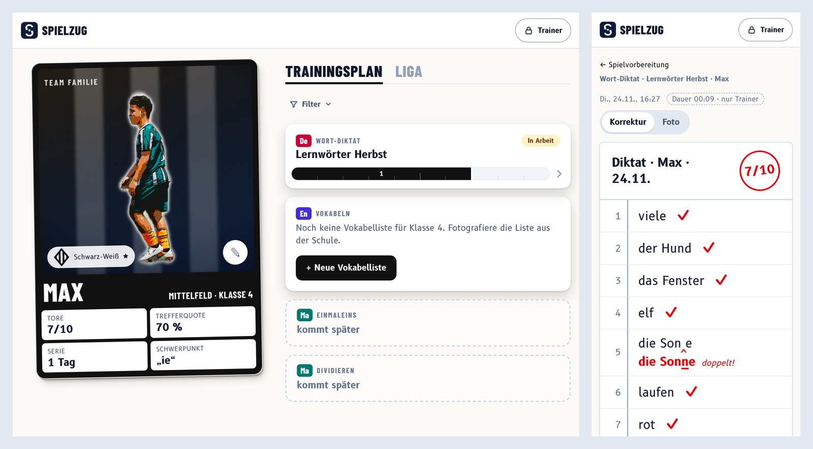
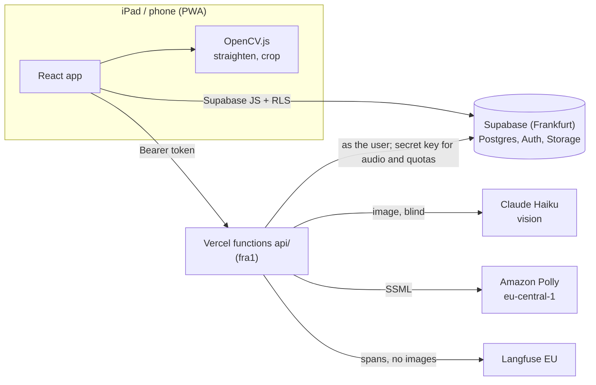

# Spielzug

A learning app for primary school children, built and run for one family as a real product, not a demo. Parents photograph the school's word list. The app dictates the words; the child writes them on paper, photographs the sheet and sees every mistake letter by letter. A football card and a league keep it fun. The UI is German.

Live: https://spielzug-nu.vercel.app (sign-up is not open to the public yet).



## How AI is used responsibly here

The app uses a vision model on children's handwriting. That calls for guardrails, and they are part of the code, the tests and the docs:

- **Read blind.** The model transcribes the dictation without seeing the expected words, so it cannot "correct" the child's spelling. A plain letter-by-letter comparison in code then decides (ADR-021).
- **Confidence threshold.** A reading below 0.3 that does not match counts as "unleserlich" (illegible), never as correct. The model does not get the benefit of the doubt.
- **Schema-checked output.** Every model answer is structured output validated with zod; an invalid answer is an error, not a guess.
- **No real AI in tests.** `AI_FAKE=1` gives fixed outputs: unit, server and E2E tests never call an LLM or the speech service, cost nothing and are deterministic.
- **Child data stays in the EU and stays minimal.** Database and files in Frankfurt (Supabase), functions in `fra1` (Vercel), speech in eu-central-1 (Amazon Polly), traces in Langfuse EU – traces carry the request and the image size, never the image. Photos are of paper only; a child's portrait is redrawn on the device and only the drawing is stored. Where every piece of data lives and when it is deleted: [data map](docs/data-map.md).
- **Row Level Security everywhere.** Every table has RLS and explicit grants; `anon` gets nothing. The policies are tested with pgTAP.
- **Cost guardrails.** Every AI endpoint needs a signed-in session; image size, token budget and timeouts are capped, and daily quotas per account plus a global cap bound the bill even with open sign-up (ADR-044).
- **Traceable requirements.** User and system requirements with status and verification ([requirements](docs/requirements.md)); tests carry the requirement id, e.g. `[SR-31]`. Lasting decisions are ADRs in [architecture](docs/architecture.md).
- **Quality gates against agent drift.** Most of the code was written with AI coding agents under binding [working agreements](docs/working-agreements.md). Lint, import rules, dead-code and duplication checks, mutation tests and a secret scan run in CI and as a pre-push hook (ADR-043).

## Architecture



## Docs

| Doc | Answers |
|---|---|
| [AGENTS.md](AGENTS.md) | entry point for agents: rules and what to read first |
| [docs/working-agreements.md](docs/working-agreements.md) | binding rules (language, child data, secrets, DB, git) |
| [docs/requirements.md](docs/requirements.md) | what it must do: UR → SR with status and verification |
| [docs/architecture.md](docs/architecture.md) | how it is built: flow, code map, routes, decisions |
| [docs/data-map.md](docs/data-map.md) | where data lives, who sees it, when it is deleted |
| [docs/verification.md](docs/verification.md) | how we know it works: test levels, manual checks |
| [docs/operations.md](docs/operations.md) | cloud services, environments, release procedure |

## Stack

| Area | Technology |
|---|---|
| Frontend | React 19, Vite, TypeScript 7, Tailwind CSS v4, React Router, TanStack Query, zod |
| Data, auth, files | Supabase (Postgres, Auth, Storage, Row Level Security), cloud project in Frankfurt |
| AI and voice | Vercel functions in `api/`: Claude Haiku reads word lists and dictations, Amazon Polly speaks the words, Langfuse traces |
| Photo preparation | OpenCV.js in the browser (straighten page or text, contrast, crop) |
| Quality | Vitest, Playwright, pgTAP (database tests), oxlint |

## Prerequisites

- Node.js 24 (`.nvmrc`)
- Docker Desktop (running) – for the local Supabase

## First-time setup

Runs entirely locally, without any cloud account or API key:

```bash
npm install
npx playwright install chromium    # browser for the E2E tests
npm run db:start                   # local Supabase in Docker (first run pulls the images)
npm run db:status                  # shows API_URL and PUBLISHABLE_KEY
```

Create `.env.local` with the local values and a PIN key of your own:

```bash
VITE_SUPABASE_URL=http://127.0.0.1:54321
VITE_SUPABASE_PUBLISHABLE_KEY=sb_publishable_...   # PUBLISHABLE_KEY from db:status
PIN_PEPPER=...                                     # openssl rand -hex 32
```

Then `AI_FAKE=1 npm run dev` (fixed AI answers, no keys, no costs) and `npm run check` (lint, quality gates, types, unit, DB and E2E tests).

**With the real AI and voice** (maintainer): put the cloud values and server keys from [`.env.example`](.env.example) into `.env.local`, and the two local `VITE_SUPABASE_*` values above into `.env.development.local`, which overrides `.env.local` in dev mode only – so `npm run dev` uses the local database with real reading and speech.

## Daily development

```bash
npm run db:start   # after a Docker or machine restart
npm run dev        # https://localhost:5173, on the LAN via the "Network" address (tablet)
```

**Local HTTPS** (optional): `npm run dev:cert` once creates `.certs/` with [mkcert](https://github.com/FiloSottile/mkcert); then the dev server runs on https. Photos work over plain http too (normal camera input). For https on the iPad, trust the mkcert root once: AirDrop `rootCA.pem` from `mkcert -CAROOT` → Settings → "Profile Downloaded" → Install, then Settings → General → About → Certificate Trust Settings → enable it. The browser reaches the local Supabase through the dev server (`/supabase` proxy) either way.

**Sign in:** "Konto erstellen" with any email address and a password (min. 8 characters), then enter the 6-digit confirmation code. Locally no real mail is sent – codes (also for "Passwort vergessen") show up in **Mailpit** (http://127.0.0.1:54324).

On the iPad: open the page in Safari → Share → "Add to Home Screen".

### Local services

`npm run db:start` runs Supabase as Docker containers (Postgres, Auth, REST API, Storage, Studio, Mailpit and more). They keep running until `npm run db:stop` or Docker quits. Data survives a stop; only `npm run db:reset` resets the database.

| Service | Address |
|---|---|
| App (Vite) | http://localhost:5173 (https after `npm run dev:cert`) |
| Supabase API (used by the app) | http://127.0.0.1:54321 |
| Supabase Studio (tables, SQL, users) | http://127.0.0.1:54323 |
| Mailpit (login codes) | http://127.0.0.1:54324 |
| Postgres directly | `127.0.0.1:54322`, credentials via `npm run db:status` |

## npm scripts

Rule: everything **local** and frequent is an npm script. Anything that changes the **cloud** stays a deliberately typed CLI command (see below).

| Script | Purpose |
|---|---|
| `npm run dev:cert` | local HTTPS certificate for localhost and the LAN address (mkcert) |
| `npm run dev` | app in dev mode (local database); also serves `api/*` against the local stack with LLM, AWS and Langfuse keys from `.env.local` – reading sheets and making audio costs real money (fractions of a cent) |
| `npm run build` / `preview` | production build (uses `.env.local`, i.e. the cloud) |
| `npm run check` | **everything before a commit:** lint, quality gates, types, unit, DB and E2E tests |
| `npm run check:fast` | lint, quality gates, types and the unit tests in `shared/` and `src/` – no Docker needed, for quick loops; also the `pre-push` hook |
| `npm run quality` | quality gates: knip (unused code and dependencies) and jscpd (duplication) – see [code quality](docs/verification.md#code-quality) |
| `npm run quality:report` | quality trends as Markdown: size, test share, duplication, fix/feat ratio, churn hotspots |
| `npm run test:mutation` | Stryker mutation testing of `shared/` (incremental; HTML in `reports/mutation/`) |
| `npm run lint` | oxlint, including the import rules (no cycles, layer boundaries) |
| `npm run typecheck` | TypeScript |
| `npm test` / `test:watch` | Vitest: dictation logic in `shared/`, photo geometry, API client, and the server functions in `api/` against the local stack (`AI_FAKE`; needs `npm run db:start`) |
| `npm run test:coverage` | `npm test` with a coverage report (text summary, HTML in `coverage/`); E2E is not measured, so UI files read low |
| `npm run test:e2e` | Playwright on tablet landscape and phone (needs local Supabase); own http server on port 5174, `AI_FAKE=1` (fixed LLM outputs, no audio) – no costs |
| `npm run test:db` | pgTAP tests: RLS, privileges, storage access (photos), trainer and team rules, profile constraints |
| `npm run db:start` / `db:stop` / `db:status` | start/stop local Supabase, show addresses and keys |
| `npm run db:reset` | rebuild the local DB from the migrations and regenerate TypeScript types – **deletes local accounts and word lists** |
| `npm run db:new -- <name>` | new empty migration |
| `npm run db:diff` | print changes made in Studio as SQL |
| `npm run db:types` | generate types from the local schema (`shared/database.types.ts`) |
| `npm run db:push:dry` | show what a cloud push would apply – changes nothing |
| `npm run release` | next version from the Conventional Commits: `package.json`, `CHANGELOG.md`, tag `vX.Y.Z` (then `git push --follow-tags`) |
| `npm run deploy:prod` | production deploy of the committed state with its commit id (only after `release`; see [operations](docs/operations.md#release-procedure)) |
| `npm run backup:prod` | read-only backup of the cloud project (database dumps and all Storage files) to `~/Backups/spielzug/` – see [operations](docs/operations.md#backups) |

**Commits and releases:** `npm install` also installs git hooks: `commit-msg` checks [Conventional Commits](docs/working-agreements.md#git), `pre-push` runs `npm run check:fast`; CI checks both again on GitHub. Versions follow SemVer and come from the commits (`npm run release`).

## Database

Supabase has **no ORM**. The schema is SQL in `supabase/migrations/` – the single source of truth. The app uses `supabase-js` through the generated REST API; type safety comes from the generated types.

### Changing the schema

The cloud database is migrated (2026-11-12), so pushed migrations are never edited again – every change is a new migration:

1. `npm run db:new -- add_something` → new file in `supabase/migrations/`
2. Write SQL (tables, RLS policies, grants – see rules)
3. `npx supabase migration up` applies it locally without losing data (or `npm run db:reset` – deletes local accounts), then `npm run db:types`
4. Add tests in `supabase/tests/database/`, run `npm run test:db`
5. Commit migration and `shared/database.types.ts` together

### Migration rules

- **RLS on every table.** Family data carries `family_id`; policies use `private.is_family_member(family_id)`.
- **Grants are always explicit.** New Supabase projects expose new tables to `anon` by default; the first migration revokes those default privileges. `anon` never gets privileges.
- What only the server may write (spoken audio) is written with the service role; members only read it.
- `security definer` functions set `search_path = ''` and revoke `execute` from `public` and `anon`.

## Environments and `.env` files

| File | Contents | Active when |
|---|---|---|
| `.env.local` | cloud Supabase, `SUPABASE_SECRET_KEY`, `DB_PW`, LLM and Langfuse keys, `AWS_*` for Polly (dictation voice), `PIN_PEPPER` (team PIN hash key), optional `DEBUG_USERS` | `build`/`preview`, server functions, Supabase CLI |
| `.env.development.local` | local Supabase URL and local publishable key | `npm run dev` (overrides `.env.local`) |
| `.env.example` | all variables without values | in the repo |

- All `.env*` files except `.env.example` are gitignored.
- Only variables prefixed `VITE_` reach the browser. **Never** name server keys with `VITE_`.

## Cloud

The CLI is logged in (`npx supabase login`) and linked (`npx supabase link --project-ref <project-ref>`). Pushing migrations, deploying and cloud settings – only with the maintainer's go – follow the [release procedure](docs/operations.md#release-procedure). Never `supabase config push`.

## Project structure

```
src/
  app/          shell: router, layout, auth guard, error and not-found pages
  features/     auth/, family/, children/, player/ (card start page), trainer/, dictation/, debug/
  components/   UI building blocks, PhotoCapture
  lib/          API client, Supabase client, speech, photo/ (sheet preparation, player portrait)
shared/         used by browser and server: dictation/ (logic, metrics), api/ (contracts, models), database.types.ts
api/            Vercel functions: word lists, dictation, audio, debug scan, team invitations, team PIN, deleting players and teams
supabase/
  migrations/   schema, RLS, grants, storage buckets
  tests/        pgTAP tests
  templates/    email template (login code)
e2e/            Playwright tests (login code via Mailpit)
docs/           see the table at the top
```

Details: [code map](docs/architecture.md#code-map).

## Troubleshooting

| Problem | Fix |
|---|---|
| No login code in Mailpit | restart `npm run dev` – Vite reads `.env.development.local` only at startup. Without the file the app talks to the cloud. |
| "Der Code konnte nicht gesendet werden" on the tablet | the app reaches Supabase through the dev server (`/supabase` proxy); check that the tablet uses the Mac's "Network" address (with `https://` once certificates exist) |
| The words are read with the device voice, not Daniel | restart `npm run dev` (AWS keys are read at startup); check `AWS_*` in `.env.local` |
| `Cannot connect to the Docker daemon` | start Docker Desktop, then `npm run db:start` |
| Port 5432x in use | another Supabase project running? `npx supabase stop --project-id <name>` |
| TypeScript errors after a schema change | `npm run db:types` |
| E2E tests fail at sign-in | local Supabase is not running (`npm run db:start`) |

## Prototype

The first version (local storage, no server) is frozen at git tag `v0.1-prototype`.

## License

Source-available under the [PolyForm Noncommercial License 1.0.0](LICENSE.md): read it, run it, learn from it and change it for any noncommercial purpose (personal use, schools, research). Commercial use needs a separate license from the author. This is deliberately not an OSI open-source license.

Third-party assets: the B612, B612 Mono and Barlow Condensed fonts (SIL Open Font License 1.1, via Fontsource), the test photo `e2e/fixtures/player.jpg` (Unsplash License, credited in `e2e/fixtures/README.md`). The club colour schemes are generic colour combinations, not club marks.
